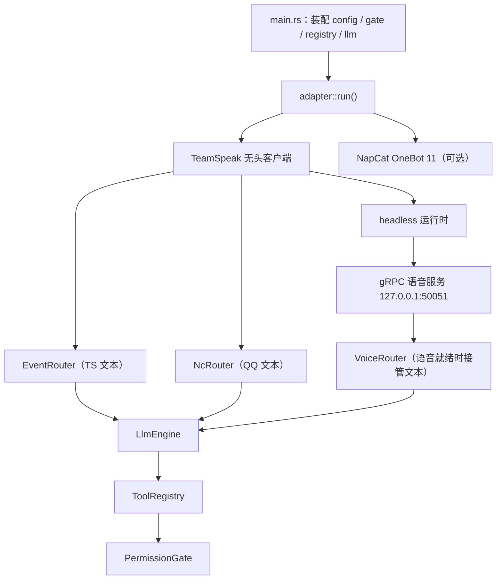

# 架构

TeamSpeakClaw 是 Rust 编写的单二进制 `teamspeakclaw` 聊天机器人，集成 TeamSpeak 无头客户端与 NapCat OneBot 11（QQ）两族入站适配器，通过 OpenAI 兼容接口驱动 LLM 工具调用。

本文只写系统拓扑与关键代码路径：模块级明细以源码为准，取舍的理由与代价见 [.agents/notes/](../.agents/notes/README.md)，目录级规则只出现在模块 `AGENTS.md` 中。

## 分层规范

- `main.rs` 只做初始化与装配，不含业务逻辑。
- 适配器层（`adapter/`）负责连接生命周期：建连、断连检测、重连。
- 路由层（`router/`）只做事件路由，不感知连接状态。

## 入口流

`main.rs` 装配 `AppConfig`、`PermissionGate`、`ToolRegistry` 与 `LlmEngine`，随后调用 `adapter::run()` 进入会话循环，并监听 Ctrl-C / SIGTERM 触发优雅关闭。

`adapter::run()` 先按需加载唤醒模型（`[headless.wakeword]`）——缺文件或模型非法直接终止启动、不进入连接——再建 TeamSpeak 连接，按需启动 NapCat（`config.napcat.enabled`）与 headless 运行时，最后经 `router::run_routers()` 并发运行 `EventRouter` 与 `NcRouter`。

任一组件失败都结束本轮会话并进入重连；退避序列、尝试上限与失败分类归 `adapter/lifecycle.rs`，归属边界见[会话生命周期归属](../.agents/notes/implemented/architecture/2026-10-07-session-lifecycle-ownership.md)。

## 入站适配器

TeamSpeak 侧（`adapter/headless.rs`）封装 `tsclient-rs::Client`：身份与建连、文本与断开事件、音频发送、gRPC 语音服务、OpenWakeWord 唤醒门；子模块划分见 `adapter/headless/`。

NapCat 侧（`adapter/napcat.rs`）是 OneBot 11 WebSocket 客户端，只在启用时连接；它自带的两处重试循环一个有界一个无界，不复用共享重连驱动。

## 路由与语音桥

voice bridge 就绪时 TS 文本经 `VoiceRouter` 路由而非 `EventRouter`，判定只有 `should_route_text_through_bridge(voice_configured, bridge_ready)` 一处；就绪由 gRPC 服务、事件流订阅与 actor handler 三个组件全 Up 决定，组件只上报 Up/Down。TS 的触发策略（私聊直触、前缀剥离、回复目标）统一由 `router/trigger.rs` 计算。

`VoiceRouter` 提供音频 STT/TTS 双流水线、唤醒门准入与唯一的出站音频 FIFO；调用者身份键、唤醒裁决归属、TTS 会话与提示音的生命周期分别见[调用者身份键](../.agents/notes/implemented/bug-fix/2026-10-15-ts-caller-identity-keys.md)、[唤醒裁决归属](../.agents/notes/implemented/architecture/2026-10-04-wake-verdict-owned-by-gate.md)、[TTS 会话归属](../.agents/notes/implemented/bug-fix/2026-10-02-tts-session-ownership.md)，在飞名额与响应体积上限是 `adapter/headless/speech.rs`、`router/voice_router.rs` 里的常量。

TS 文本路由、工具回复与语音桥 `send_notice` 共用 `text_util` 的唯一发送实现，`split_message()` 按 TS3 ServerQuery 的 8192 字节单行上限做 UTF-8 安全切分。

## LLM 引擎与提示词

`llm/` 分四块：引擎入口、OpenAI 兼容客户端、上下文与轮次协调、流式工具循环。TS 文本、NapCat 与语音三条入口共用 `router/turn.rs` 的回合骨架，见 [LLM 回合模块](../.agents/notes/implemented/architecture/2026-10-03-llm-turn-module.md)。

`prompt/` 是模型可见提示词的唯一归属地：system 提示词与 TTS 风格提示都是其中的有序段落常量，由回合装配一次；上下文与音频历史的体积预算、体积类失败的收缩重试见 [重试恢复](../.agents/notes/implemented/bug-fix/2026-10-15-payload-retry-recovery.md)。

## 权限与工具

`permission.rs` 的 `PermissionGate` 按 `acl.toml` 的服务组与频道组规则给出工具白名单，`allowed_skills` 作为旧键仍可解析；受保护组的目标交互另有授权开关。

`tools.rs` 的 `Tool` trait 与 `ToolRegistry` 是模型可调用函数的唯一注册处，工具实现统一收 `UnifiedExecutionContext`，按用途分 `communication`、`information`、`moderation`、`music`、`web_search` 五组；代码侧一律用「工具」一词，见 [命名统一](../.agents/notes/implemented/architecture/2026-10-12-tool-vocabulary-rename.md)。

## 组件图

