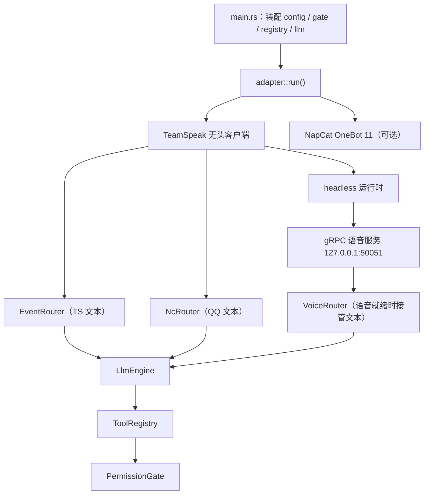

# 架构

TeamSpeakClaw 是 Rust 编写的单二进制 `teamspeakclaw` 聊天机器人，集成 TeamSpeak 无头客户端与 NapCat OneBot 11（QQ）两族入站适配器，通过 OpenAI 兼容接口驱动 LLM 工具调用。

本文是索引与拓扑：分层规则、入口流、子系统一览与组件图。每个子系统的契约、关键序列与不变量见其专页；取舍的理由与代价见 [.agents/notes/](../.agents/notes/README.md)，目录级规则只出现在模块 `AGENTS.md` 中。

## 分层规范

- `main.rs` 只做初始化与装配，不含业务逻辑。
- 适配器层（`adapter/`）负责连接生命周期：建连、断连检测、重连。
- 路由层（`router/`）只做事件路由，不感知连接状态。

## 入口流

`main.rs` 装配 `AppConfig`、`PermissionGate`、`ToolRegistry` 与 `LlmEngine`，随后调用 `adapter::run()` 进入会话循环并监听 Ctrl-C / SIGTERM 优雅关闭。

`adapter::run()` 先按需加载唤醒模型，再建 TeamSpeak 连接，按需启动 NapCat 与 headless 运行时，最后经 `router::run_routers()` 并发运行 `EventRouter` 与 `NcRouter`。

voice bridge 就绪时 TS 文本经 `VoiceRouter` 而非 `EventRouter` 路由；三条入站路径的回合最终都由 `LlmEngine` 处理，工具调用经 `ToolRegistry` 过 `PermissionGate`。细节见[会话生命周期与重连](subsystems/lifecycle.md)、[事件路由与回合准入](subsystems/routing.md)。

## 子系统

| 子系统 | 拥有 | 代码入口 |
|---|---|---|
| [会话生命周期与重连](subsystems/lifecycle.md) | 装配、连接生命周期、重连退避、就绪与关闭 | `main.rs`、`adapter.rs`、`adapter/lifecycle.rs` |
| [TeamSpeak 无头客户端](subsystems/ts-client.md) | 客户端封装、身份、事件、音频发送、文本分片 | `adapter/headless.rs`、`adapter/headless/` |
| [gRPC 语音桥](subsystems/voice-bridge.md) | 进程内语音服务、事件广播、bridge 就绪 | `adapter/headless/voice_service.rs`、`proto/voice.proto` |
| [唤醒门](subsystems/wakeword.md) | OpenWakeWord 判定、说话人状态、插话触发 | `adapter/headless/wakeword.rs`、`adapter/headless/wakeword/` |
| [语音回合](subsystems/voice-turns.md) | STT/TTS 流水线、回合准入与取消、出站音频 | `router/voice_router.rs`、`router/voice_turns.rs` |
| [NapCat OneBot 11 适配器](subsystems/napcat.md) | WebSocket 连接、动作调用、上行事件解析 | `adapter/napcat.rs`、`adapter/napcat/` |
| [事件路由与回合准入](subsystems/routing.md) | 路由循环、触发策略、回合骨架与门禁 | `router.rs`、`router/turn.rs`、`router/trigger.rs` |
| [LLM 引擎与上下文](subsystems/llm.md) | provider、上下文与音频预算、工具循环 | `llm.rs`、`llm/` |
| [模型可见提示词装配](subsystems/prompt.md) | 有序段落、变量解析、运行期上下文快照 | `prompt.rs`、`prompt/` |
| [工具系统与权限门](subsystems/tools.md) | Tool 注册表、执行上下文、ACL 判定 | `tools.rs`、`tools/`、`permission.rs` |
| [配置加载与日志](subsystems/config.md) | 配置文件与目录约定、日志初始化 | `config.rs`、`config/`、`log.rs` |

## 新行为放哪里

| 目标 | 归属 |
|---|---|
| 新增或修改模型可调用的工具 | `tools/` 下对应分组，注册表在 `tools.rs` |
| 新增模型可见的提示词内容 | `prompt/sections.rs` 的段落常量 |
| 新增配置项 | `config/` 下对应子模块，示例同步 `examples/config/` |
| 新增 TeamSpeak 侧行为 | `adapter/headless/` 的对应子模块 |
| 新增 QQ 侧动作或事件 | `adapter/napcat/` 的 `api` / `event` |
| 改动回合的准入、取消或落库 | `router/turn.rs` 与 `llm/context.rs` |
| 改动唤醒判定 | `adapter/headless/wakeword.rs` 与唤醒门的说话人状态 |
| 新增跨适配器的协调逻辑 | `adapter/lifecycle.rs` |
| 新增终端活动区、连接状态或运行时状态栏 | `ui.rs`；控制台日志接线在 `log.rs` |

## 组件图

